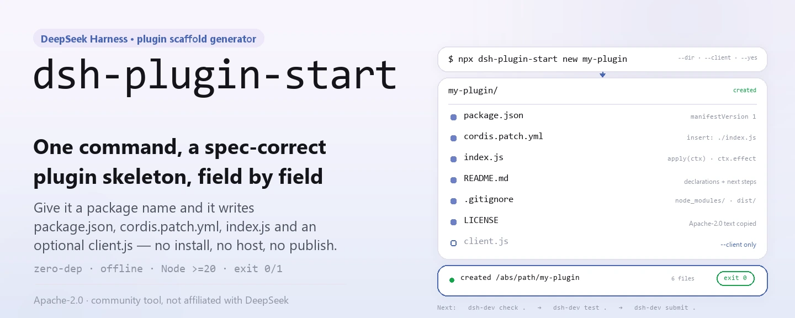
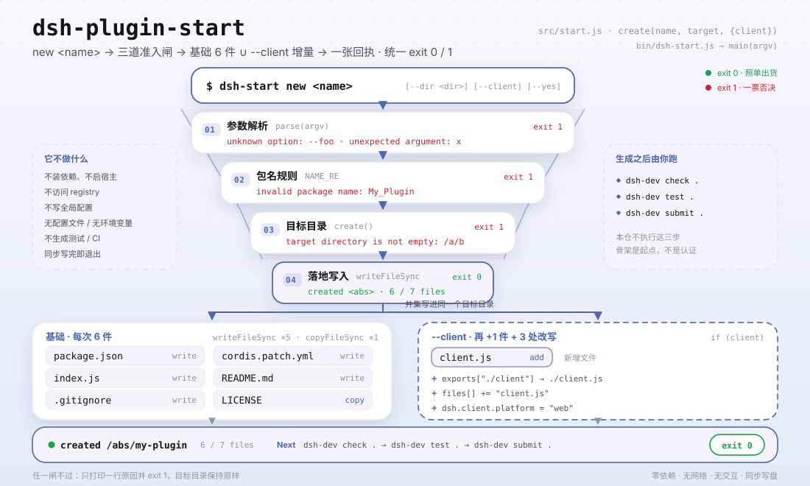

<div align="center">

<picture>
  <source media="(prefers-color-scheme: dark)" srcset="docs/assets/dsh-plugin-start-hero-en-dark.webp">
  
</picture>

# dsh-plugin-start

**One command scaffolds a DeepSeek Harness plugin skeleton that passes host-spec checks.**

No dependency install, no host boot, no publish — it just writes `package.json`, `cordis.patch.yml`, `index.js`, and optionally `client.js` into the target directory, shaped to the current spec.

[Install](#three-step-setup) · [Configuration](#configuration) · [FAQ](#faq) · [简体中文](README.md) · [English](README.en.md) · [Español](README.es.md) · [Português](README.pt.md) · [हिन्दी](README.hi.md)

[](LICENSE)
[](https://www.npmjs.com/package/dsh-plugin-start)
[](https://github.com/PerryLink/dsh-plugin-start/actions/workflows/test.yml)
[](#development)

[](https://github.com/PerryLink/dsh-plugin-start/stargazers)
[](https://www.npmjs.com/package/dsh-plugin-start)
[](https://gitee.com/perrylink/dsh-plugin-start)

```sh
npx dsh-plugin-start new my-plugin
# or install globally and use the short command
npm i -g dsh-plugin-start
dsh-start new my-plugin
```

</div>

<sub>Community tool, not affiliated with DeepSeek. Canonical repository: <https://github.com/PerryLink/dsh-plugin-start> (Gitee is a mirror).</sub>

## What it is

`dsh-plugin-start` is a zero-dependency Node CLI: give it a package name and it writes a minimal but current DeepSeek Harness plugin skeleton into the target directory — `package.json` (with `dsh.manifestVersion`, `dsh.bundle.patch`, `engines.dsh`, and the host-enforced `peerDependencies["@deepseek-ai/dsh"]`), `cordis.patch.yml`, an `index.js` with a `ctx.effect` dispose shape, plus `README.md`, `LICENSE`, and `.gitignore`; add `--client` for a `client.js` and a `./client` export.

It only generates: it does not install dependencies, run a host, or publish, and it never claims your plugin is ready. Run `dsh-dev check .` → `dsh-dev test .` → `dsh-dev submit .` afterwards — that is where the skeleton starts proving itself.

<picture>
  <source media="(prefers-color-scheme: dark)" srcset="docs/assets/dsh-plugin-start-flow-v5-dark.svg">
  
</picture>

## Three-step setup

1. **Install** (pick one):

   ```sh
   # no install needed — run the latest published version
   npx dsh-plugin-start new my-plugin
   # or install globally and use dsh-start
   npm i -g dsh-plugin-start
   dsh-start new my-plugin
   ```

   Requires Node.js `>=20`; the package has no runtime dependencies.

2. **Generate the skeleton** (`--dir` changes the target, `--client` adds the browser half):

   ```sh
   dsh-start new my-plugin --dir ./plugins/my-plugin --client --yes
   ```

   Without `--dir` the target is `./my-plugin`; `--yes` is a non-interactive marker kept for scripts — this tool never prompts.

3. **Verify** (the generator only guarantees file shape; checks are what count):

   ```sh
   cd my-plugin
   dsh-dev check .
   dsh-dev test .
   dsh-dev submit .
   ```

   On success it prints `created <absolute path>` plus the list of written files and exits `0`; bad arguments or an unwritable directory exit `1` with the specific reason.

**Uninstall**: `npm uninstall -g dsh-plugin-start` (nothing to uninstall when using `npx`).

## Core capabilities

- **Complete skeleton in one command** — writes `package.json`, `cordis.patch.yml`, `index.js`, `README.md`, `LICENSE`, and `.gitignore`; `--client` additionally writes `client.js`.
- **Host-spec fields filled in** — manifest version, bundle patch path, `engines.dsh`, and `peerDependencies` come from one generator, so you cannot forget a field copied from an old template.
- **Clean dispose shape** — `apply(ctx)` wraps resources in `ctx.effect(() => () => {})`, so stop and hot-reload can unwind them.
- **Optional browser half** — `--client` writes `client.js` and updates `exports["./client"]`, `files`, and `dsh.client.platform = "web"` together.
- **Pure file generation, no network, no prompts** — no dependency fetch, no registry access, no global state; files are written once and failures end in a non-zero exit code.

### Commands

| Command | Effect |
|---|---|
| `dsh-start new <name>` | Generate the skeleton in `./<name>`; the target must not exist or must be empty |
| `dsh-start new <name> --dir <dir>` | Choose the target directory (`-d` is equivalent) |
| `dsh-start new <name> --client` | Also generate `client.js` and the `./client` export |
| `dsh-start --help` · `-h` | Print usage, options, and the generated-file list |
| `dsh-start --version` · `-v` | Print the version (read from this package's `package.json`) |

### Generated files

| File | Key content |
|---|---|
| `package.json` | `version: "0.1.0"`, `type: "module"`, `engines.node: ">=20"`, `engines.dsh: ">=0.2.0 <0.3.0"`, `dsh.manifestVersion: 1`, `dsh.bundle.patch: "./cordis.patch.yml"`, `dsh.capabilities` / `dsh.labels` as empty arrays |
| `cordis.patch.yml` | One `insert` entry binding `<name>` to `./index.js` |
| `index.js` | Exports `name`, `inject = []`, and `apply(ctx)`; resources live inside `ctx.effect` |
| `client.js` | Only with `--client`: exports `name` and an empty `apply()` |
| `README.md` | Declaration notes, next commands, and a publish checklist for the generated plugin |
| `LICENSE` | A copy of this repository's full Apache-2.0 text |
| `.gitignore` | `node_modules/`, `dist/`, `*.log`, `.DS_Store` |

## Configuration

`dsh-plugin-start` has no config file, environment variables, or persistent state; every behavior comes from command-line arguments.

Common arguments:

| Argument | Default | Meaning |
|---|---|---|
| `--dir <dir>` / `-d` | `./<name>` | Target directory; created if missing, rejected if present and non-empty |
| `--client` | off | Adds the browser half: `client.js`, `./client` export, `dsh.client.platform: "web"` |
| `--yes` / `-y` | off | Non-interactive marker; the tool never prompts, the flag exists for script consistency |
| `--help` / `-h` | — | Print help and exit `0` |
| `--version` / `-v` | — | Print the version and exit `0` |

<details>
<summary>Full argument table, name rules, and exit codes</summary>

| Argument | Default | Meaning |
|---|---|---|
| `new` | required | Subcommand; it is the only one today |
| `<name>` | required | Plugin package name, must match `^[a-z0-9][a-z0-9-]*$`: lowercase letters, digits, hyphens, starting with a letter or digit |
| `--dir <dir>` / `-d` | `./<name>` | Target directory; relative paths resolve against the current working directory, created recursively |
| `--client` | off | Also writes `client.js` and adds `exports["./client"]`, `files[]`, and `dsh.client.platform` |
| `--yes` / `-y` | off | Non-interactive marker; parsed but changes no behavior |
| `--help` / `-h` | off | Print `usage()` and exit `0` |
| `--version` / `-v` | off | Print this package's version and exit `0` |

Exit codes:

| Exit code | Situation |
|---|---|
| `0` | Generation succeeded, or `--help` / `--version` |
| `1` | Missing name, unknown option, extra argument, invalid name, non-empty target, or write failure |

Declarations the generator hard-codes into `package.json` (edit the generated file when you need to change them):

| Field | Value |
|---|---|
| `dsh.manifestVersion` | `1` |
| `dsh.bundle.patch` | `./cordis.patch.yml` |
| `dsh.capabilities` | `[]` (explicitly "uses none") |
| `dsh.labels` | `[]` |
| `engines.dsh` | `>=0.2.0 <0.3.0` |
| `peerDependencies["@deepseek-ai/dsh"]` | `>=0.2.0 <0.3.0` |
| `dsh.client.platform` | `"web"` (only with `--client`) |

</details>

## FAQ

<details>
<summary>Can I install and use the generated plugin right away?</summary>

Not yet. The generator only makes the file shape correct; it does not install dependencies, run a host, or verify plugin behavior. The generated README lists the path forward: add `repository`, `homepage`, and the `dsh-plugin` topic, run `dsh-dev check .` and `dsh-dev test .`, run `dsh-ready .` until every fail is gone, feed a real host install to `entry-validate --host-evidence`, and only then talk about publishing. The skeleton is a start, not a certification or a host-install result.

</details>

<details>
<summary>What happens if the target directory already exists?</summary>

Missing means it is created recursively; existing but empty means it can be written into; existing and non-empty aborts with `target directory is not empty: <absolute path>` and exit code `1`. There is no `--force` or overwrite switch today — pick another name or empty the directory first.

</details>

<details>
<summary>Does it install dependencies, start a host, or publish for me?</summary>

No to all three. It is a pure file generator: no network requests, no child processes, no npm registry contact, no global config writes. Generation is synchronous and exits as soon as the files are written; `dsh-dev` and `dsh-ready` are always run by you, explicitly.

</details>

<details>
<summary>What exactly does <code>--client</code> add?</summary>

Three things: a new `client.js` (exports `name` and an empty `apply()`), `"./client": "./client.js"` under `package.json.exports`, `client.js` in `files[]`, and `dsh.client = { platform: "web" }`. Without the flag, `exports["./client"]` stays absent.

</details>

<details>
<summary>Why are capabilities and labels empty arrays?</summary>

An empty array explicitly says "this plugin uses none of them", which is harder to misread than a missing field. Add what the code actually uses later: `ctx.fs` needs `fs:read` (plus `fs:write` for writes), `ctx.tools.register` needs `tools:register`; calling an API without its declaration turns the checker's hint into a failure. `package.json` is JSON, so it cannot carry comments — the fields are the only declaration surface.

</details>

<details>
<summary>Any restrictions on the package name?</summary>

Only `^[a-z0-9][a-z0-9-]*$` is accepted: lowercase letters, digits, and hyphens, starting with a letter or digit. Uppercase, underscores, and `@scope/name` are rejected with `invalid package name`. The generator never rewrites the name for you.

</details>

## Known limitations

- **It generates, it does not verify.** Template fields and files are guaranteed present, but nothing guarantees the generated plugin loads, passes checks, or is usable in any way; `dsh-dev check .` is the first real gate.
- **Not a certification, audit, or endorsement.** A successful generation does not mean official approval, market listing, or a successful host install — each of those needs separate evidence and process.
- **The version range is hard-coded.** Generated `engines.dsh` and `peerDependencies` are fixed at `>=0.2.0 <0.3.0`; when the host spec moves, edit the generated `package.json` by hand or wait for a new release of this tool.
- **No overwrite mode.** A non-empty target is rejected; there is no `--force`, merge, or backup. Deal with the old directory before regenerating.
- **Narrow name rule.** Scoped names, uppercase, and underscores are unsupported by design, so the manifest stays directly publishable.
- **No tests, CI, or publish config generated.** The output is the minimum a plugin needs to run; tests, workflows, and npm credentials are yours to add.
- **Apache-2.0 only.** `LICENSE` is copied verbatim from this repository; there is no license option.
- **No interactivity.** No questions, confirmations, or wizard; `--yes` is only a placeholder flag for scripts.

## Development

```sh
git clone https://github.com/PerryLink/dsh-plugin-start.git
cd dsh-plugin-start
npm test                                  # node --test test/*.test.js
node bin/dsh-start.js --help              # run the CLI locally
node bin/dsh-start.js new demo --dir ../demo --yes
python scripts/gen-readme-assets.py       # regenerate the hero and diagram pair in docs/assets
```

No build step and no runtime dependencies: `bin/dsh-start.js` calls `src/start.js` directly, and the tests use `node:test` to cover three branches in temp directories (default skeleton, `--client`, non-empty target rejection). The asset script needs Python plus Pillow and probes for a system CJK font; when none is found it exits instead of drawing tofu boxes. The heroes are rendered as zh / en WebP pairs; the structure diagram carries command and field tokens only, so all five README languages share the same SVG pair.

Topics: `dsh`, `dsh-plugin`, `deepseek-harness`, `scaffold`, `starter`

## Family and credits

This project is part of the [PerryLink](https://github.com/PerryLink) family of DeepSeek Harness tools and plugins (all Apache-2.0). If this generator saves you from hand-copying a template, **give it a star** — it unlocks nothing, but it helps the next person who needs a skeleton find it.

## License

[LICENSE](LICENSE) (Apache License 2.0) © 2026 dsh-plugin-start contributors

<p align="center"><sub>Apache-2.0 · Community tool, not affiliated with DeepSeek.</sub></p>
