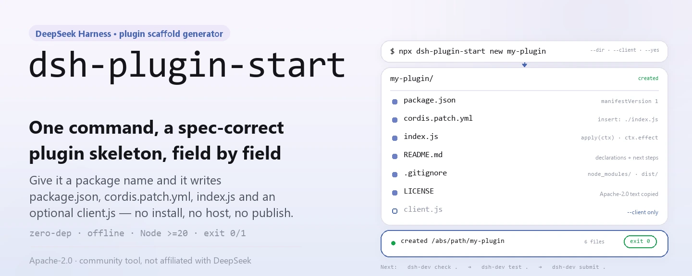
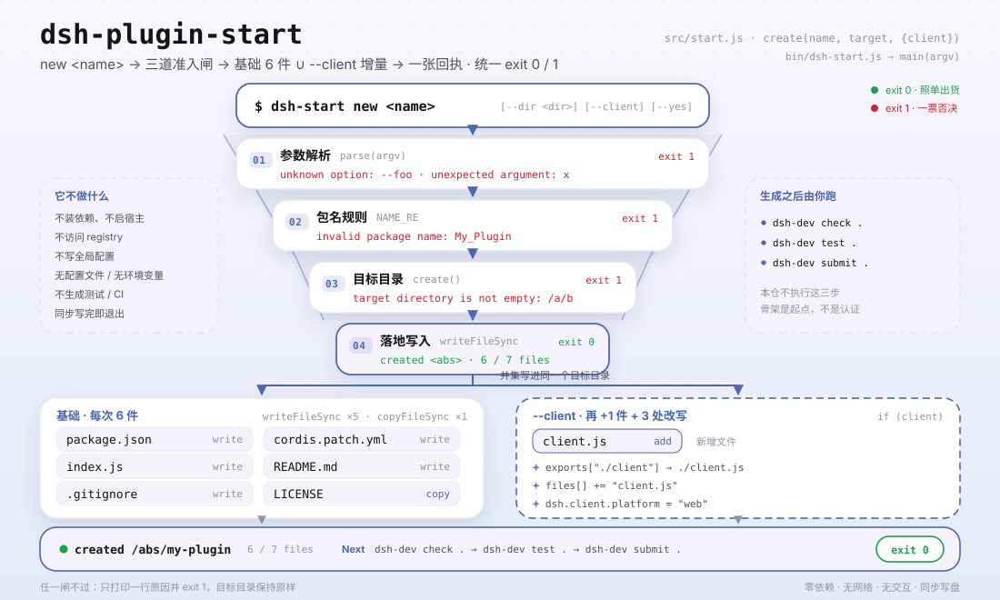

<div align="center">

<picture>
  <source media="(prefers-color-scheme: dark)" srcset="docs/assets/dsh-plugin-start-hero-en-dark.webp">
  
</picture>

# dsh-plugin-start

**Un comando genera un esqueleto de plugin de DeepSeek Harness con la forma actual del manifiesto.**

Sin instalar dependencias, sin arrancar un host y sin publicar: solo escribe `package.json`, `cordis.patch.yml`, `index.js` y, si se pide, `client.js` en el directorio de destino con la forma de la especificación actual.

[Instalación](#instalación-en-tres-pasos) · [Configuración](#configuración) · [FAQ](#faq) · [简体中文](README.md) · [English](README.en.md) · [Español](README.es.md) · [Português](README.pt.md) · [हिन्दी](README.hi.md)

[](LICENSE)
[](https://www.npmjs.com/package/dsh-plugin-start)
[](https://github.com/PerryLink/dsh-plugin-start/actions/workflows/test.yml)
[](#desarrollo)

[](https://github.com/PerryLink/dsh-plugin-start/stargazers)
[](https://www.npmjs.com/package/dsh-plugin-start)
[](https://gitee.com/perrylink/dsh-plugin-start)

```sh
npx dsh-plugin-start new my-plugin
# o instala globalmente y usa el comando corto
npm i -g dsh-plugin-start
dsh-start new my-plugin
```

</div>

<sub>Herramienta comunitaria, sin relación con DeepSeek. Repositorio canónico: <https://github.com/PerryLink/dsh-plugin-start> (Gitee es un espejo).</sub>

## Qué es

`dsh-plugin-start` es una CLI Node sin dependencias: le das un nombre de paquete y escribe un esqueleto mínimo pero actual de plugin de DeepSeek Harness en el directorio de destino — `package.json` (con `dsh.manifestVersion`, `dsh.bundle.patch`, `engines.dsh` y el `peerDependencies["@deepseek-ai/dsh"]` que impone el host), `cordis.patch.yml`, un `index.js` con la forma de liberación `ctx.effect`, más `README.md`, `LICENSE` y `.gitignore`; con `--client` añade `client.js` y la exportación `./client`.

Solo genera: no instala dependencias, no ejecuta un host ni publica, y nunca afirma que tu plugin esté listo. Ejecuta `npx -y dsh-standards@1.6.11 check . --scope entry --entry-claim static --no-exec --host-version 0.2.2-rc.3` para una comprobación estática de solo lectura, luego `npm pack --dry-run` y `dsh plugin --profile demo add .` para el empaquetado y una prueba de instalación: ahí es donde el esqueleto empieza a demostrar que sirve.

<picture>
  <source media="(prefers-color-scheme: dark)" srcset="docs/assets/dsh-plugin-start-flow-v5-dark.svg">
  
</picture>

## Instalación en tres pasos

1. **Instalar** (elige una):

   ```sh
   # sin instalar nada: ejecuta la última versión publicada
   npx dsh-plugin-start new my-plugin
   # o instala globalmente y usa dsh-start
   npm i -g dsh-plugin-start
   dsh-start new my-plugin
   ```

   La CLI en sí requiere Node.js `>=20` (sin dependencias); el esqueleto generado declara `engines.node: ">=24.9.0"`, porque la línea 0.2.2 de DSH exige Node `>=24.9.0`.

2. **Generar el esqueleto** (`--dir` cambia el destino, `--client` añade la mitad de navegador):

   ```sh
   dsh-start new my-plugin --dir ./plugins/my-plugin --client --yes
   ```

   Sin `--dir` el destino es `./my-plugin`; `--yes` es una marca no interactiva pensada para scripts: esta herramienta nunca pregunta.

3. **Verificar** (el generador solo garantiza la forma de los archivos; lo que cuenta son las comprobaciones):

   ```sh
   cd my-plugin
   npx -y dsh-standards@1.6.11 check . --scope entry --entry-claim static --no-exec --host-version 0.2.2-rc.3
   npm pack --dry-run
   dsh plugin --profile demo add .
   ```

   Si todo va bien imprime `created <ruta absoluta>` y la lista de archivos escritos, y sale con `0`; los argumentos inválidos o un directorio no escribible salen con `1` y el motivo concreto.

**Desinstalar**: `npm uninstall -g dsh-plugin-start` (con `npx` no hay nada que desinstalar).

## Capacidades principales

- **Esqueleto completo en un comando** — escribe `package.json`, `cordis.patch.yml`, `index.js`, `README.md`, `LICENSE` y `.gitignore`; con `--client` añade `client.js`.
- **Campos del host ya rellenados** — la versión del manifiesto, la ruta del bundle patch, `engines.dsh` y `peerDependencies` salen de un único generador, así no se te olvida ningún campo copiado de una plantilla vieja.
- **Forma de liberación limpia** — `apply(ctx)` envuelve los recursos en `ctx.effect(() => () => {})`, de modo que parar o recargar en caliente puede deshacerlos.
- **Mitad de navegador opcional** — `--client` escribe `client.js` y actualiza a la vez `exports["./client"]`, `files` y `dsh.client.platform = "web"`; la fila de `cordis.patch.yml` mantiene el nombre desnudo del paquete como `name` (un nombre relativo como `./index.js` no se engancha a la mitad de navegador).
- **Generación de archivos pura, sin red y sin preguntas** — no descarga dependencias, no accede al registry ni escribe estado global; los archivos se escriben una vez y los fallos terminan con código de salida distinto de cero.

### Comandos

| Comando | Efecto |
|---|---|
| `dsh-start new <name>` | Genera el esqueleto en `./<name>`; el destino no debe existir o debe estar vacío |
| `dsh-start new <name> --dir <dir>` | Elige el directorio de destino (`-d` es equivalente) |
| `dsh-start new <name> --client` | Genera además `client.js` y la exportación `./client` |
| `dsh-start --help` · `-h` | Muestra uso, opciones y la lista de archivos generados |
| `dsh-start --version` · `-v` | Muestra la versión (leída del `package.json` de este paquete) |

### Archivos generados

| Archivo | Contenido clave |
|---|---|
| `package.json` | `version: "0.1.0"`, `type: "module"`, `engines.node: ">=24.9.0"`, `engines.dsh: ">=0.2.2-0 <0.3.0"`, `dsh.manifestVersion: 1`, `dsh.bundle.patch: "./cordis.patch.yml"`, `dsh.capabilities` / `dsh.labels` como arrays vacíos |
| `cordis.patch.yml` | Una fila `insert` cuyo `name` es el nombre desnudo del paquete `<name>` (no `./index.js`); esa fila también permite al host enganchar la mitad de navegador y es una precondición del G4 del bundle smoke |
| `index.js` | Exporta `name`, `inject = []` y `apply(ctx)`; los recursos viven dentro de `ctx.effect` |
| `client.js` | Solo con `--client`: exporta `name` y un `apply()` vacío |
| `README.md` | Notas de declaración, siguientes comandos y lista de publicación para el plugin generado |
| `LICENSE` | Copia del texto completo de Apache-2.0 de este repositorio |
| `.gitignore` | `node_modules/`, `dist/`, `*.log`, `.DS_Store` |

## Configuración

`dsh-plugin-start` no tiene archivo de configuración, variables de entorno ni estado persistente; todo su comportamiento viene de los argumentos de línea de comandos.

Argumentos habituales:

| Argumento | Valor por defecto | Significado |
|---|---|---|
| `--dir <dir>` / `-d` | `./<name>` | Directorio de destino; se crea si falta y se rechaza si existe y no está vacío |
| `--client` | desactivado | Añade la mitad de navegador: `client.js`, exportación `./client`, `dsh.client.platform: "web"` |
| `--yes` / `-y` | desactivado | Marca no interactiva; la herramienta nunca pregunta, la opción existe por coherencia con scripts |
| `--help` / `-h` | — | Muestra la ayuda y sale con `0` |
| `--version` / `-v` | — | Muestra la versión y sale con `0` |

<details>
<summary>Tabla completa de argumentos, reglas de nombre y códigos de salida</summary>

| Argumento | Valor por defecto | Significado |
|---|---|---|
| `new` | obligatorio | Subcomando; hoy es el único |
| `<name>` | obligatorio | Nombre del paquete, debe cumplir `^[a-z0-9][a-z0-9-]*$`: letras minúsculas, dígitos y guiones, empezando por letra o dígito |
| `--dir <dir>` / `-d` | `./<name>` | Directorio de destino; las rutas relativas se resuelven contra el directorio de trabajo actual y se crean de forma recursiva |
| `--client` | desactivado | Escribe también `client.js` y añade `exports["./client"]`, `files[]` y `dsh.client.platform` |
| `--yes` / `-y` | desactivado | Marca no interactiva; se analiza pero no cambia ningún comportamiento |
| `--help` / `-h` | desactivado | Imprime `usage()` y sale con `0` |
| `--version` / `-v` | desactivado | Imprime la versión de este paquete y sale con `0` |

Códigos de salida:

| Código | Situación |
|---|---|
| `0` | Generación correcta, o `--help` / `--version` |
| `1` | Falta el nombre, opción desconocida, argumento de más, nombre inválido, destino no vacío o fallo de escritura |

Declaraciones que el generador fija en `package.json` (edita el archivo generado si necesitas cambiarlas):

| Campo | Valor |
|---|---|
| `dsh.manifestVersion` | `1` |
| `dsh.bundle.patch` | `./cordis.patch.yml` |
| `dsh.capabilities` | `[]` (equivale a «no usa ninguna») |
| `dsh.labels` | `[]` |
| `engines.dsh` | `>=0.2.2-0 <0.3.0` |
| `peerDependencies["@deepseek-ai/dsh"]` | `>=0.2.2-0 <0.3.0` |
| `dsh.client.platform` | `"web"` (solo con `--client`) |

</details>

## FAQ

<details>
<summary>¿Puedo instalar y usar el plugin generado de inmediato?</summary>

Todavía no. El generador solo deja correcta la forma de los archivos; no instala dependencias, no ejecuta un host ni verifica el comportamiento del plugin. El README generado indica el camino: añade `repository`, `homepage` y el topic `dsh-plugin`, ejecuta la comprobación estática de arriba y `npm pack --dry-run`, instala el checkout en un profile temporal y arranca el host una vez; solo entonces habla de publicar. El esqueleto es un punto de partida, no una certificación ni un resultado de instalación en el host.

</details>

<details>
<summary>¿Qué pasa si el directorio de destino ya existe?</summary>

Si falta, se crea de forma recursiva; si existe pero está vacío, se puede escribir en él; si existe y no está vacío, aborta con `target directory is not empty: <ruta absoluta>` y código de salida `1`. Hoy no hay `--force` ni opción de sobrescritura: elige otro nombre o vacía el directorio antes.

</details>

<details>
<summary>¿Instala dependencias, arranca un host o publica por mí?</summary>

No a las tres cosas. Es un generador de archivos puro: sin peticiones de red, sin procesos hijos, sin contacto con el registry de npm y sin escribir configuración global. La generación es síncrona y termina en cuanto escribe los archivos; la comprobación estática y la prueba de instalación siempre las ejecutas tú, de forma explícita.

</details>

<details>
<summary>¿Qué añade exactamente <code>--client</code>?</summary>

Tres cosas: un `client.js` nuevo (exporta `name` y un `apply()` vacío), `"./client": "./client.js"` en `package.json.exports`, `client.js` en `files[]` y `dsh.client = { platform: "web" }`. Sin la opción, `exports["./client"]` sigue ausente.

</details>

<details>
<summary>¿Por qué capabilities y labels son arrays vacíos?</summary>

Un array vacío dice explícitamente «no usa ninguno de ellos», lo que es más difícil de malinterpretar que un campo ausente. Añade después lo que el código use de verdad: `ctx.fs` necesita `fs:read` (y `fs:write` para escribir), `ctx.tools.register` necesita `tools:register`; llamar a una API sin su declaración convierte la pista del comprobador en un fallo. `package.json` es JSON, así que no admite comentarios: los campos son la única superficie de declaración.

</details>

<details>
<summary>¿Hay restricciones en el nombre del paquete?</summary>

Solo se acepta `^[a-z0-9][a-z0-9-]*$`: letras minúsculas, dígitos y guiones, empezando por letra o dígito. Mayúsculas, guiones bajos y `@scope/name` se rechazan con `invalid package name`. El generador nunca reescribe el nombre por ti.

</details>

## Limitaciones conocidas

- **Genera, no verifica.** Se garantiza que los campos y archivos de la plantilla están presentes, pero nada garantiza que el plugin generado cargue, pase las comprobaciones o sea utilizable; `npx -y dsh-standards@1.6.11 check . --scope entry --entry-claim static --no-exec --host-version 0.2.2-rc.3` es la primera puerta real. Solo cubre la parte estática de ENTRY y no es un resultado de runtime ni de instalación; C-2 solo se juzga porque el comando pasa `--host-version` (sin él es NA, no un aprobado).
- **No es una certificación, auditoría ni respaldo.** Una generación correcta no significa aprobación oficial, inclusión en un mercado ni instalación correcta en el host: cada cosa exige pruebas y procesos aparte.
- **El rango de versiones está fijado.** `engines.dsh` y `peerDependencies` generados se fijan en `>=0.2.2-0 <0.3.0`; cuando cambie la especificación del host, edita el `package.json` generado a mano o espera una nueva versión de esta herramienta.
- **Sin modo de sobrescritura.** Un destino no vacío se rechaza; no hay `--force`, fusión ni copia de seguridad. Resuelve el directorio antiguo antes de regenerar.
- **Regla de nombre estrecha.** Los nombres con scope, mayúsculas y guiones bajos no se admiten por diseño, para que el manifiesto siga siendo publicable directamente.
- **No genera tests, CI ni configuración de publicación.** La salida es lo mínimo que un plugin necesita para ejecutarse; los tests, los workflows y las credenciales de npm los añades tú.
- **Solo Apache-2.0.** `LICENSE` se copia tal cual de este repositorio; no hay opción de licencia.
- **Sin interactividad.** Sin preguntas, confirmaciones ni asistente; `--yes` es solo una marca de compatibilidad para scripts.

## Desarrollo

```sh
git clone https://github.com/PerryLink/dsh-plugin-start.git
cd dsh-plugin-start
npm test                                  # node --test test/*.test.js
node bin/dsh-start.js --help              # ejecuta la CLI en local
node bin/dsh-start.js new demo --dir ../demo --yes
python scripts/gen-readme-assets.py       # regenera el hero y el diagrama en docs/assets
```

Sin paso de compilación ni dependencias de ejecución: `bin/dsh-start.js` llama directamente a `src/start.js` y los tests usan `node:test` para cubrir tres ramas en directorios temporales (esqueleto por defecto, `--client`, rechazo de destino no vacío). El script de imágenes necesita Python y Pillow, y busca una fuente CJK del sistema; si no la encuentra, sale en vez de dibujar cuadros vacíos. El hero se genera como par WebP zh / en; el diagrama estructural solo contiene tokens de comandos y campos, así que los cinco idiomas del README comparten el mismo par SVG.

Topics: `dsh`, `dsh-plugin`, `deepseek-harness`, `scaffold`, `starter`

## Familia y créditos

Este proyecto forma parte de la familia [PerryLink](https://github.com/PerryLink) de herramientas y plugins de DeepSeek Harness (todos Apache-2.0). Si este generador te ahorra copiar una plantilla a mano, **dale una estrella**: no desbloquea nada, pero ayuda a que la próxima persona que necesite un esqueleto lo encuentre.

## Licencia

[LICENSE](LICENSE) (Apache License 2.0) © 2026 dsh-plugin-start contributors

<p align="center"><sub>Apache-2.0 · Herramienta comunitaria, sin relación con DeepSeek.</sub></p>
