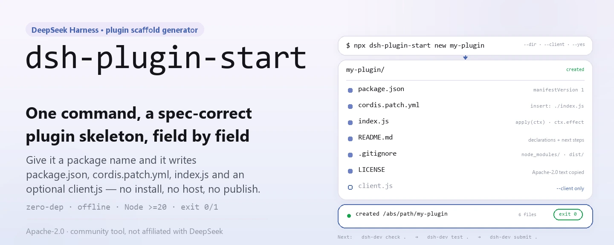
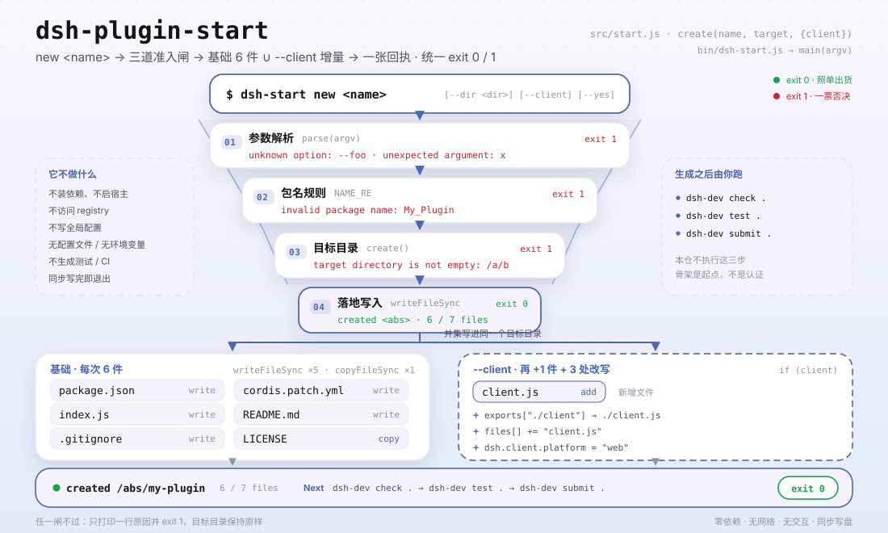

<div align="center">

<picture>
  <source media="(prefers-color-scheme: dark)" srcset="docs/assets/dsh-plugin-start-hero-en-dark.webp">
  
</picture>

# dsh-plugin-start

**एक कमांड ऐसा DeepSeek Harness प्लगइन ढांचा बनाता है जो होस्ट विनिर्देश की जाँच पास करता है।**

कोई निर्भरता इंस्टॉल नहीं, होस्ट नहीं चलता, कुछ प्रकाशित नहीं — बस लक्ष्य निर्देशिका में मौजूदा विनिर्देश के अनुसार `package.json`, `cordis.patch.yml`, `index.js` और वैकल्पिक रूप से `client.js` लिखता है।

[इंस्टॉल](#तीन-चरणों-में-शुरुआत) · [कॉन्फ़िगरेशन](#कॉन्फ़िगरेशन) · [FAQ](#faq) · [简体中文](README.md) · [English](README.en.md) · [Español](README.es.md) · [Português](README.pt.md) · [हिन्दी](README.hi.md)

[](LICENSE)
[](https://www.npmjs.com/package/dsh-plugin-start)
[](https://github.com/PerryLink/dsh-plugin-start/actions/workflows/test.yml)
[](#विकास)

[](https://github.com/PerryLink/dsh-plugin-start/stargazers)
[](https://www.npmjs.com/package/dsh-plugin-start)
[](https://gitee.com/perrylink/dsh-plugin-start)

```sh
npx dsh-plugin-start new my-plugin
# या ग्लोबल इंस्टॉल के बाद छोटा कमांड
npm i -g dsh-plugin-start
dsh-start new my-plugin
```

</div>

<sub>सामुदायिक टूल, DeepSeek से संबद्ध नहीं। मुख्य रेपो: <https://github.com/PerryLink/dsh-plugin-start> (Gitee प्रतिबिंब है)।</sub>

## यह क्या है

`dsh-plugin-start` एक शून्य-निर्भरता वाला Node CLI है: आप पैकेज का नाम देते हैं और यह लक्ष्य निर्देशिका में न्यूनतम लेकिन मौजूदा DeepSeek Harness प्लगइन विनिर्देश के अनुरूप ढांचा लिख देता है — `package.json` (जिसमें `dsh.manifestVersion`, `dsh.bundle.patch`, `engines.dsh` और होस्ट द्वारा अनिवार्य `peerDependencies["@deepseek-ai/dsh"]` है), `cordis.patch.yml`, `ctx.effect` रिलीज़ आकार वाला `index.js`, साथ में `README.md`, `LICENSE` और `.gitignore`; `--client` के साथ `client.js` और `./client` निर्यात भी।

यह केवल जनरेट करता है: निर्भरताएँ इंस्टॉल नहीं करता, होस्ट नहीं चलाता, प्रकाशित नहीं करता और यह कभी नहीं कहता कि आपका प्लगइन तैयार है। इसके बाद `dsh-dev check .` → `dsh-dev test .` → `dsh-dev submit .` चलाएँ — ढांचा वहीं से उपयोगी साबित होना शुरू करता है।

<picture>
  <source media="(prefers-color-scheme: dark)" srcset="docs/assets/dsh-plugin-start-flow-v5-dark.svg">
  
</picture>

## तीन चरणों में शुरुआत

1. **इंस्टॉल करें** (कोई एक चुनें):

   ```sh
   # बिना इंस्टॉल: सीधे नवीनतम प्रकाशित संस्करण चलाएँ
   npx dsh-plugin-start new my-plugin
   # या ग्लोबल इंस्टॉल करके dsh-start इस्तेमाल करें
   npm i -g dsh-plugin-start
   dsh-start new my-plugin
   ```

   Node.js `>=20` आवश्यक है; पैकेज में कोई रनटाइम निर्भरता नहीं है।

2. **ढांचा बनाएँ** (`--dir` लक्ष्य बदलता है, `--client` ब्राउज़र हिस्सा जोड़ता है):

   ```sh
   dsh-start new my-plugin --dir ./plugins/my-plugin --client --yes
   ```

   `--dir` के बिना लक्ष्य `./my-plugin` है; `--yes` स्क्रिप्ट के लिए रखा गया गैर-इंटरैक्टिव चिह्न है — यह टूल कभी प्रश्न नहीं पूछता।

3. **सत्यापित करें** (जनरेटर केवल फ़ाइलों का आकार सुनिश्चित करता है; असली मापदंड जाँच है):

   ```sh
   cd my-plugin
   dsh-dev check .
   dsh-dev test .
   dsh-dev submit .
   ```

   सफल होने पर यह `created <पूर्ण पथ>` और लिखी गई फ़ाइलों की सूची दिखाता है और `0` के साथ बाहर निकलता है; गलत आर्ग्युमेंट या लिखने योग्य न होने पर `1` और स्पष्ट कारण।

**अनइंस्टॉल**: `npm uninstall -g dsh-plugin-start` (`npx` में कुछ अनइंस्टॉल करने को नहीं है)।

## मुख्य क्षमताएँ

- **एक कमांड में पूरा ढांचा** — `package.json`, `cordis.patch.yml`, `index.js`, `README.md`, `LICENSE` और `.gitignore` लिखता है; `--client` के साथ `client.js` भी।
- **होस्ट विनिर्देश के फ़ील्ड पहले से भरे** — मैनिफ़ेस्ट संस्करण, बंडल पैच पथ, `engines.dsh` और `peerDependencies` एक ही जनरेटर से आते हैं, इसलिए पुराने टेम्पलेट से नकल करते समय कोई फ़ील्ड नहीं छूटती।
- **साफ़ रिलीज़ आकार** — `apply(ctx)` संसाधनों को `ctx.effect(() => () => {})` में लपेटता है, ताकि रोकना या हॉट-रीलोड उन्हें वापस ले सके।
- **वैकल्पिक ब्राउज़र हिस्सा** — `--client` `client.js` लिखता है और साथ ही `exports["./client"]`, `files` तथा `dsh.client.platform = "web"` अपडेट करता है।
- **शुद्ध फ़ाइल जनरेशन, बिना नेटवर्क, बिना प्रश्न** — कोई निर्भरता डाउनलोड नहीं, registry तक पहुँच नहीं, वैश्विक स्थिति नहीं; फ़ाइलें एक बार लिखी जाती हैं और विफलता गैर-शून्य एक्ज़िट कोड पर समाप्त होती है।

### कमांड

| कमांड | प्रभाव |
|---|---|
| `dsh-start new <name>` | `./<name>` में ढांचा बनाता है; लक्ष्य मौजूद न हो या खाली हो |
| `dsh-start new <name> --dir <dir>` | लक्ष्य निर्देशिका चुनता है (`-d` समान है) |
| `dsh-start new <name> --client` | अतिरिक्त रूप से `client.js` और `./client` निर्यात बनाता है |
| `dsh-start --help` · `-h` | उपयोग, विकल्प और बनाई गई फ़ाइलों की सूची दिखाता है |
| `dsh-start --version` · `-v` | संस्करण दिखाता है (इस पैकेज के `package.json` से) |

### बनाई गई फ़ाइलें

| फ़ाइल | मुख्य सामग्री |
|---|---|
| `package.json` | `version: "0.1.0"`, `type: "module"`, `engines.node: ">=20"`, `engines.dsh: ">=0.2.0 <0.3.0"`, `dsh.manifestVersion: 1`, `dsh.bundle.patch: "./cordis.patch.yml"`, `dsh.capabilities` / `dsh.labels` खाली arrays |
| `cordis.patch.yml` | एक `insert` प्रविष्टि जो `<name>` को `./index.js` से जोड़ती है |
| `index.js` | `name`, `inject = []` और `apply(ctx)` निर्यात करता है; संसाधन `ctx.effect` के अंदर रहते हैं |
| `client.js` | केवल `--client` के साथ: `name` और खाली `apply()` निर्यात करता है |
| `README.md` | घोषणा नोट्स, अगले कमांड और बने प्लगइन की प्रकाशन सूची |
| `LICENSE` | इस रेपो की पूरी Apache-2.0 प्रति |
| `.gitignore` | `node_modules/`, `dist/`, `*.log`, `.DS_Store` |

## कॉन्फ़िगरेशन

`dsh-plugin-start` में कोई कॉन्फ़िग फ़ाइल, पर्यावरण चर या स्थायी स्थिति नहीं है; सारा व्यवहार कमांड-लाइन आर्ग्युमेंट से आता है।

सामान्य आर्ग्युमेंट:

| आर्ग्युमेंट | डिफ़ॉल्ट | अर्थ |
|---|---|---|
| `--dir <dir>` / `-d` | `./<name>` | लक्ष्य निर्देशिका; न हो तो बनती है, मौजूद और खाली न हो तो अस्वीकार |
| `--client` | बंद | ब्राउज़र हिस्सा जोड़ता है: `client.js`, `./client` निर्यात, `dsh.client.platform: "web"` |
| `--yes` / `-y` | बंद | गैर-इंटरैक्टिव चिह्न; टूल कभी प्रश्न नहीं पूछता, यह विकल्प स्क्रिप्ट की एकरूपता के लिए है |
| `--help` / `-h` | — | सहायता दिखाकर `0` से बाहर |
| `--version` / `-v` | — | संस्करण दिखाकर `0` से बाहर |

<details>
<summary>पूरी आर्ग्युमेंट तालिका, नाम नियम और एक्ज़िट कोड</summary>

| आर्ग्युमेंट | डिफ़ॉल्ट | अर्थ |
|---|---|---|
| `new` | आवश्यक | सबकमांड; आज यही एकमात्र है |
| `<name>` | आवश्यक | पैकेज नाम, `^[a-z0-9][a-z0-9-]*$` से मेल खाना चाहिए: छोटे अक्षर, अंक, हाइफ़न; शुरुआत अक्षर या अंक से |
| `--dir <dir>` / `-d` | `./<name>` | लक्ष्य निर्देशिका; सापेक्ष पथ वर्तमान कार्य निर्देशिका से हल होते हैं और पुनरावर्ती रूप से बनते हैं |
| `--client` | बंद | `client.js` भी लिखता है और `exports["./client"]`, `files[]` तथा `dsh.client.platform` जोड़ता है |
| `--yes` / `-y` | बंद | गैर-इंटरैक्टिव चिह्न; पढ़ा जाता है पर व्यवहार नहीं बदलता |
| `--help` / `-h` | बंद | `usage()` छापकर `0` से बाहर |
| `--version` / `-v` | बंद | इस पैकेज का संस्करण छापकर `0` से बाहर |

एक्ज़िट कोड:

| कोड | स्थिति |
|---|---|
| `0` | जनरेशन सफल, या `--help` / `--version` |
| `1` | नाम नहीं, अज्ञात विकल्प, अतिरिक्त आर्ग्युमेंट, अमान्य नाम, गैर-रिक्त लक्ष्य या लेखन विफलता |

जनरेटर `package.json` में जो घोषणाएँ तय करता है (बदलना हो तो बनी फ़ाइल संपादित करें):

| फ़ील्ड | मान |
|---|---|
| `dsh.manifestVersion` | `1` |
| `dsh.bundle.patch` | `./cordis.patch.yml` |
| `dsh.capabilities` | `[]` (स्पष्ट रूप से "कोई क्षमता नहीं") |
| `dsh.labels` | `[]` |
| `engines.dsh` | `>=0.2.0 <0.3.0` |
| `peerDependencies["@deepseek-ai/dsh"]` | `>=0.2.0 <0.3.0` |
| `dsh.client.platform` | `"web"` (केवल `--client` के साथ) |

</details>

## FAQ

<details>
<summary>क्या बना हुआ प्लगइन तुरंत इंस्टॉल और उपयोग कर सकता हूँ?</summary>

अभी नहीं। जनरेटर केवल फ़ाइलों का आकार सही करता है; वह निर्भरताएँ इंस्टॉल नहीं करता, होस्ट नहीं चलाता और प्लगइन का व्यवहार सत्यापित नहीं करता। बना हुआ README आगे का रास्ता बताता है: `repository`, `homepage` और `dsh-plugin` topic जोड़ें, `dsh-dev check .` और `dsh-dev test .` चलाएँ, `dsh-ready .` तब तक चलाएँ जब तक सभी fail खत्म न हों, असली होस्ट इंस्टॉल को `entry-validate --host-evidence` तक पहुँचाएँ, और उसके बाद ही प्रकाशन की बात करें। ढांचा शुरुआत है, प्रमाणन या होस्ट-इंस्टॉल परिणाम नहीं।

</details>

<details>
<summary>लक्ष्य निर्देशिका पहले से मौजूद हो तो क्या होगा?</summary>

न हो तो पुनरावर्ती रूप से बनती है; मौजूद पर खाली हो तो लिखा जा सकता है; मौजूद और खाली न हो तो `target directory is not empty: <पूर्ण पथ>` के साथ रुक जाता है और एक्ज़िट कोड `1` देता है। अभी `--force` या अधिलेखन विकल्प नहीं है — दूसरा नाम चुनें या पहले निर्देशिका खाली करें।

</details>

<details>
<summary>क्या यह मेरे लिए निर्भरताएँ इंस्टॉल करता है, होस्ट चलाता है या प्रकाशित करता है?</summary>

तीनों नहीं। यह शुद्ध फ़ाइल जनरेटर है: कोई नेटवर्क अनुरोध नहीं, कोई चाइल्ड प्रोसेस नहीं, npm registry से संपर्क नहीं और वैश्विक कॉन्फ़िगरेशन नहीं लिखता। जनरेशन सिंक्रोनस है और फ़ाइलें लिखते ही समाप्त हो जाता है; `dsh-dev` और `dsh-ready` हमेशा आप स्वयं स्पष्ट रूप से चलाते हैं।

</details>

<details>
<summary><code>--client</code> वास्तव में क्या जोड़ता है?</summary>

तीन चीज़ें: नया `client.js` (`name` और खाली `apply()` निर्यात करता है), `package.json.exports` में `"./client": "./client.js"`, `files[]` में `client.js`, और `dsh.client = { platform: "web" }`। विकल्प के बिना `exports["./client"]` अनुपस्थित रहता है।

</details>

<details>
<summary>capabilities और labels खाली arrays क्यों हैं?</summary>

खाली array स्पष्ट रूप से कहता है "इनमें से कोई नहीं", जिसे अनुपस्थित फ़ील्ड की तुलना में गलत समझना कठिन है। बाद में वही जोड़ें जो कोड वास्तव में उपयोग करता है: `ctx.fs` को `fs:read` चाहिए (लिखने के लिए `fs:write` भी), `ctx.tools.register` को `tools:register`; घोषणा के बिना API कॉल करने पर जाँचकर्ता का संकेत विफलता बन जाता है। `package.json` JSON है, इसलिए टिप्पणियाँ नहीं रख सकता — फ़ील्ड ही एकमात्र घोषणा सतह हैं।

</details>

<details>
<summary>पैकेज नाम पर क्या प्रतिबंध हैं?</summary>

केवल `^[a-z0-9][a-z0-9-]*$` स्वीकार होता है: छोटे अक्षर, अंक और हाइफ़न, शुरुआत अक्षर या अंक से। बड़े अक्षर, अंडरस्कोर और `@scope/name` को `invalid package name` के साथ अस्वीकार किया जाता है। जनरेटर आपके लिए नाम कभी नहीं बदलता।

</details>

## ज्ञात सीमाएँ

- **जनरेट करता है, सत्यापित नहीं।** टेम्पलेट के फ़ील्ड और फ़ाइलों की उपस्थिति सुनिश्चित है, पर यह कोई गारंटी नहीं कि बना प्लगइन लोड हो, जाँच पास करे या किसी भी तरह उपयोगी हो; `dsh-dev check .` पहला असली द्वार है।
- **प्रमाणन, ऑडिट या समर्थन नहीं।** सफल जनरेशन का अर्थ आधिकारिक स्वीकृति, मार्केट में सूचीबद्धता या होस्ट इंस्टॉल की सफलता नहीं है — हर चीज़ के लिए अलग प्रमाण और प्रक्रिया चाहिए।
- **संस्करण सीमा स्थिर है।** बने `engines.dsh` और `peerDependencies` `>=0.2.0 <0.3.0` पर तय हैं; होस्ट विनिर्देश बदलने पर बनी `package.json` हाथ से संपादित करें या इस टूल के नए संस्करण की प्रतीक्षा करें।
- **कोई अधिलेखन मोड नहीं।** गैर-रिक्त लक्ष्य अस्वीकार होता है; `--force`, मर्ज या बैकअप नहीं है। फिर से बनाने से पहले पुरानी निर्देशिका संभालें।
- **संकीर्ण नाम नियम।** scoped नाम, बड़े अक्षर और अंडरस्कोर जानबूझकर असमर्थित हैं ताकि मैनिफ़ेस्ट सीधे प्रकाशन योग्य रहे।
- **टेस्ट, CI या प्रकाशन कॉन्फ़िग नहीं बनाता।** आउटपुट उतना ही है जितना प्लगइन को चलने के लिए चाहिए; टेस्ट, workflow और npm क्रेडेंशियल आपको जोड़ने हैं।
- **केवल Apache-2.0।** `LICENSE` इस रेपो से ज्यों का त्यों कॉपी होती है; लाइसेंस का कोई विकल्प नहीं।
- **कोई इंटरैक्टिविटी नहीं।** प्रश्न, पुष्टि या विज़ार्ड नहीं; `--yes` केवल स्क्रिप्ट के लिए अनुकूलता चिह्न है।

## विकास

```sh
git clone https://github.com/PerryLink/dsh-plugin-start.git
cd dsh-plugin-start
npm test                                  # node --test test/*.test.js
node bin/dsh-start.js --help              # CLI स्थानीय रूप से चलाएँ
node bin/dsh-start.js new demo --dir ../demo --yes
python scripts/gen-readme-assets.py       # docs/assets में हीरो और आरेख फिर बनाएँ
```

कोई बिल्ड चरण नहीं और कोई रनटाइम निर्भरता नहीं: `bin/dsh-start.js` सीधे `src/start.js` कहता है और टेस्ट `node:test` से तीन शाखाएँ अस्थायी निर्देशिकाओं में जाँचते हैं (डिफ़ॉल्ट ढांचा, `--client`, गैर-रिक्त लक्ष्य की अस्वीकृति)। इमेज स्क्रिप्ट को Python और Pillow चाहिए और वह सिस्टम CJK फ़ॉन्ट खोजती है; न मिलने पर खाली बक्से बनाने के बजाय बाहर निकल जाती है। हीरो zh / en के लिए WebP में बनता है; संरचना आरेख में केवल कमांड और फ़ील्ड tokens हैं, इसलिए पाँचों भाषाओं के README एक ही SVG जोड़ी साझा करते हैं।

Topics: `dsh`, `dsh-plugin`, `deepseek-harness`, `scaffold`, `starter`

## परिवार और आभार

यह परियोजना [PerryLink](https://github.com/PerryLink) के DeepSeek Harness टूल और प्लगइन परिवार का हिस्सा है (सभी Apache-2.0)। अगर यह जनरेटर आपको टेम्पलेट हाथ से नकल करने से बचाता है, तो **एक star दें** — इससे कोई सुविधा नहीं खुलती, पर अगले व्यक्ति को ढांचा ढूँढना आसान होता है।

## लाइसेंस

[LICENSE](LICENSE) (Apache License 2.0) © 2026 dsh-plugin-start contributors

<p align="center"><sub>Apache-2.0 · सामुदायिक टूल, DeepSeek से संबद्ध नहीं।</sub></p>
