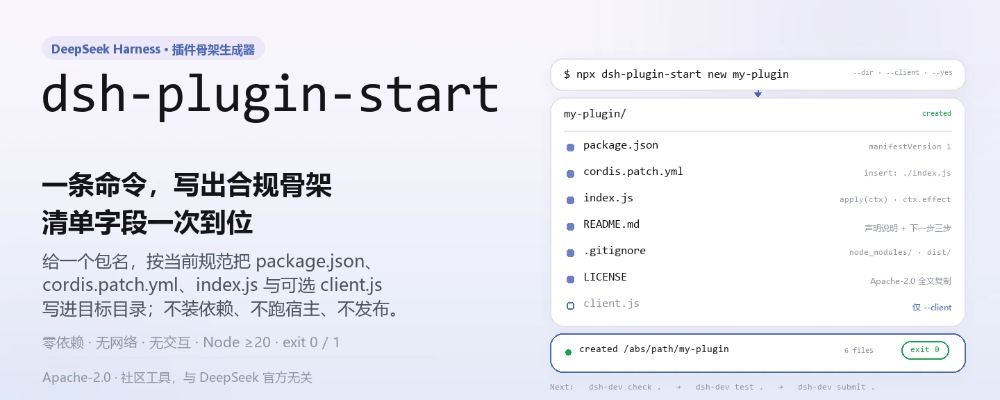
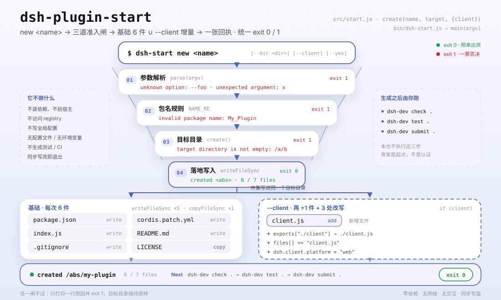

<div align="center">

<picture>
  <source media="(prefers-color-scheme: dark)" srcset="docs/assets/dsh-plugin-start-hero-zh-dark.webp">
  
</picture>

# dsh-plugin-start

**一条命令生成能通过宿主规范校验的 DeepSeek Harness 插件骨架。**

不装依赖、不启动宿主、不发布——只把 `package.json`、`cordis.patch.yml`、`index.js` 和可选的 `client.js` 按当前规范写进目标目录。

[安装](#三步上手) · [配置](#配置参数) · [FAQ](#faq) · [简体中文](README.md) · [English](README.en.md) · [Español](README.es.md) · [Português](README.pt.md) · [हिन्दी](README.hi.md)

[](LICENSE)
[](https://www.npmjs.com/package/dsh-plugin-start)
[](https://github.com/PerryLink/dsh-plugin-start/actions/workflows/test.yml)
[](#开发)

[](https://github.com/PerryLink/dsh-plugin-start/stargazers)
[](https://www.npmjs.com/package/dsh-plugin-start)
[](https://gitee.com/perrylink/dsh-plugin-start)

```sh
npx dsh-plugin-start new my-plugin
# 或全局安装后使用短命令
npm i -g dsh-plugin-start
dsh-start new my-plugin
```

</div>

<sub>社区工具，与 DeepSeek 官方无关。唯一仓库：<https://github.com/PerryLink/dsh-plugin-start>（Gitee 为镜像）。</sub>

## 它是什么

`dsh-plugin-start` 是一个零依赖 Node CLI：给一个包名，它在目标目录写出一个最小但符合当前 DeepSeek Harness 插件规范的骨架——`package.json`（含 `dsh.manifestVersion`、`dsh.bundle.patch`、`engines.dsh` 与宿主强制的 `peerDependencies["@deepseek-ai/dsh"]`）、`cordis.patch.yml`、带 `ctx.effect` 释放形状的 `index.js`，以及 `README.md`、`LICENSE`、`.gitignore`；加 `--client` 再多一个 `client.js` 与 `./client` 导出。

它只做生成：不安装依赖、不跑宿主、不发布，也不声称你的插件已经可用。生成后把 `dsh-dev check .` → `dsh-dev test .` → `dsh-dev submit .` 跑一遍，骨架才算真正起步。

<picture>
  <source media="(prefers-color-scheme: dark)" srcset="docs/assets/dsh-plugin-start-flow-v5-dark.svg">
  
</picture>

## 三步上手

1. **安装**（任选其一）：

   ```sh
   # 免安装，直接跑最新发布版
   npx dsh-plugin-start new my-plugin
   # 或全局安装，后续用短命令 dsh-start
   npm i -g dsh-plugin-start
   dsh-start new my-plugin
   ```

   要求 Node.js `>=20`；包本身没有运行时依赖。

2. **生成骨架**（`--dir` 可换目标目录，`--client` 额外生成浏览器半）：

   ```sh
   dsh-start new my-plugin \
     --dir ./plugins/my-plugin \
     --client --yes
   ```

   不加 `--dir` 时目标为当前目录下的 `my-plugin/`；`--yes` 只是为脚本保留的非交互标记，这个工具从不会提问。

3. **验证**（生成器只保证文件形状，跑通校验才算数）：

   ```sh
   cd my-plugin
   dsh-dev check .
   dsh-dev test .
   dsh-dev submit .
   ```

   生成成功时命令会打印 `created <绝对路径>` 和写入的文件清单，退出码为 `0`；参数有误或目录不可写时退出码为 `1`，并打印具体原因。

**卸载**：`npm uninstall -g dsh-plugin-start`（用 `npx` 的话无需卸载）。

## 核心能力

- **一条命令出完整骨架** —— 生成 `package.json`、`cordis.patch.yml`、`index.js`、`README.md`、`LICENSE`、`.gitignore`；`--client` 时追加 `client.js`。
- **宿主规范字段一次到位** —— 清单版本、bundle patch 路径、`engines.dsh` 与 `peerDependencies` 由生成器统一填写，避免手抄旧模板漏字段。
- **干净的释放形状** —— `index.js` 的 `apply(ctx)` 用 `ctx.effect(() => () => {})` 包裹资源，停止或热重载时可撤销。
- **可选浏览器半** —— `--client` 写入 `client.js`，并同步 `exports["./client"]`、`files` 与 `dsh.client.platform = "web"`。
- **纯文件生成、无网络、无交互** —— 不拉依赖、不访问 registry、不写全局状态；文件逐个写入，失败以非零退出码收场。

### 命令

| 命令 | 作用 |
|---|---|
| `dsh-start new <name>` | 在 `./<name>` 生成插件骨架；目标目录必须不存在或为空 |
| `dsh-start new <name> --dir <dir>` | 指定目标目录（`-d` 同义） |
| `dsh-start new <name> --client` | 额外生成 `client.js` 与 `./client` 导出 |
| `dsh-start --help` · `-h` | 打印用法、选项与生成物清单 |
| `dsh-start --version` · `-v` | 打印版本号（取自本包 `package.json`） |

### 生成物

| 文件 | 关键内容 |
|---|---|
| `package.json` | `version: "0.1.0"`、`type: "module"`、`engines.node: ">=20"`、`engines.dsh: ">=0.2.0 <0.3.0"`、`dsh.manifestVersion: 1`、`dsh.bundle.patch: "./cordis.patch.yml"`、`dsh.capabilities` / `dsh.labels` 为空数组 |
| `cordis.patch.yml` | 一行 `insert`，把 `<name>` 指向 `./index.js` |
| `index.js` | 导出 `name`、`inject = []` 与 `apply(ctx)`；资源放在 `ctx.effect` 内 |
| `client.js` | 仅 `--client`：导出 `name` 与空 `apply()` |
| `README.md` | 生成物的声明说明、下一步命令与发布清单 |
| `LICENSE` | 复制本仓库的 Apache-2.0 全文 |
| `.gitignore` | `node_modules/`、`dist/`、`*.log`、`.DS_Store` |

## 配置/参数

`dsh-plugin-start` 没有配置文件、环境变量或持久化状态；所有行为由命令行参数决定。

常用参数：

| 参数 | 默认值 | 含义 |
|---|---|---|
| `--dir <dir>` / `-d` | `./<name>` | 目标目录；不存在则创建，存在但非空则拒绝 |
| `--client` | 关闭 | 增加浏览器半：`client.js`、`./client` 导出、`dsh.client.platform: "web"` |
| `--yes` / `-y` | 关闭 | 非交互标记；工具本身从不提问，保留它是为了脚本写法一致 |
| `--help` / `-h` | — | 打印帮助后退出 `0` |
| `--version` / `-v` | — | 打印版本后退出 `0` |

<details>
<summary>完整参数表、包名规则与退出码</summary>

| 参数 | 默认值 | 含义 |
|---|---|---|
| `new` | 必需 | 子命令；当前只有这一个子命令 |
| `<name>` | 必需 | 插件包名，须匹配 `^[a-z0-9][a-z0-9-]*$`：小写字母、数字、连字符，且以字母或数字开头 |
| `--dir <dir>` / `-d` | `./<name>` | 目标目录；相对路径按当前工作目录解析，不存在会递归创建 |
| `--client` | 关闭 | 额外写 `client.js`，并补 `exports["./client"]`、`files[]` 与 `dsh.client.platform` |
| `--yes` / `-y` | 关闭 | 非交互标记；解析后不改变任何行为 |
| `--help` / `-h` | 关闭 | 打印 `usage()` 并以 `0` 退出 |
| `--version` / `-v` | 关闭 | 打印本包版本并以 `0` 退出 |

退出码：

| 退出码 | 场景 |
|---|---|
| `0` | 生成成功，或 `--help` / `--version` |
| `1` | 缺少包名、未知选项、多余参数、包名不合法、目标目录非空、写入失败 |

生成器在 `package.json` 里固定写入的声明（需要变更时直接改生成后的文件）：

| 字段 | 值 |
|---|---|
| `dsh.manifestVersion` | `1` |
| `dsh.bundle.patch` | `./cordis.patch.yml` |
| `dsh.capabilities` | `[]`（显式表示“不使用任何能力”） |
| `dsh.labels` | `[]` |
| `engines.dsh` | `>=0.2.0 <0.3.0` |
| `peerDependencies["@deepseek-ai/dsh"]` | `>=0.2.0 <0.3.0` |
| `dsh.client.platform` | `"web"`（仅 `--client`） |

</details>

## FAQ

<details>
<summary>生成完就能直接安装使用了吗？</summary>

还不能。生成器只负责“文件形状正确”，不安装依赖、不跑宿主，也不验证插件行为。生成物的 README 已列出后续路径：补 `repository` / `homepage` / `dsh-plugin` topic，运行 `dsh-dev check .`、`dsh-dev test .`，再跑 `dsh-ready .` 修掉所有 fail，把真实宿主安装结果喂给 `entry-validate --host-evidence`，最后才谈发布。骨架是起点，不是认证或宿主安装结果。

</details>

<details>
<summary>目标目录已存在会发生什么？</summary>

不存在就递归创建；存在但为空可以写入；存在且非空会直接报 `target directory is not empty: <绝对路径>` 并以 `1` 退出。目前没有 `--force` 或覆盖开关，换一个目录名或先清空目录即可。

</details>

<details>
<summary>它会替我安装依赖、启动宿主或发布吗？</summary>

都不会。它是纯文件生成器：没有网络请求，没有子进程，不碰 npm registry，也不写全局配置。生成本身是同步的，写完即退出；后续的 `dsh-dev` 与 `dsh-ready` 都由你显式执行。

</details>

<details>
<summary><code>--client</code> 到底多生成了什么？</summary>

三处：新增 `client.js`（导出 `name` 与空 `apply()`）、在 `package.json.exports` 加 `"./client": "./client.js"`、在 `files[]` 加 `client.js`，并写入 `dsh.client = { platform: "web" }`。不加时 `exports["./client"]` 保持不存在。

</details>

<details>
<summary>为什么生成物里的 capabilities / labels 是空数组？</summary>

空数组是显式声明“这个插件不使用任何能力/标签”，比缺字段更不容易被误读。之后代码用到什么就补什么：`ctx.fs` 需要 `fs:read`（写文件再加 `fs:write`），`ctx.tools.register` 需要 `tools:register`；一旦调用了对应 API 却没声明，检查器的提示会变成失败。`package.json` 是 JSON，不能写注释，声明只能靠字段本身。

</details>

<details>
<summary>包名有什么限制？</summary>

只接受 `^[a-z0-9][a-z0-9-]*$`：小写字母、数字与连字符，首字符必须是字母或数字。大写、下划线、`@scope/name` 都会被拒绝并打印 `invalid package name`。生成器不会替你改写包名。

</details>

## 已知限制

- **只生成，不校验。** 它保证模板字段与文件齐全，不保证生成的插件能加载、能通过检查或以任何方式可用；`dsh-dev check .` 才是第一道真实门禁。
- **不是认证、审计或背书。** 生成成功不代表官方认可、市场收录或宿主安装成功；这些都需要另外的证据与流程。
- **版本区间是写死的。** 生成物固定 `engines.dsh` 与 `peerDependencies` 为 `>=0.2.0 <0.3.0`；宿主规范变化后需要手动改生成后的 `package.json`，或等本工具发新版本。
- **没有覆盖模式。** 目标目录非空即拒绝，不提供 `--force`、合并或备份；重复生成前请自行处理旧目录。
- **包名规则偏窄。** 不支持 scoped 包名、大写与下划线；这是有意的，避免生成无法直接发布的清单。
- **不生成测试、CI、发布配置。** 生成物只有插件运行所需的最小文件；测试、workflow、npm 发布凭据都要你自己补。
- **固定 Apache-2.0。** `LICENSE` 直接复制本仓库的 Apache-2.0 全文，没有其他许可证选项。
- **无交互。** 没有提问、确认或向导；`--yes` 只是兼容脚本的占位标记。

## 开发

```sh
git clone https://github.com/PerryLink/dsh-plugin-start.git
cd dsh-plugin-start
npm test                                  # node --test test/*.test.js
node bin/dsh-start.js --help              # 本地跑 CLI
node bin/dsh-start.js new demo --dir ../demo --yes
python scripts/gen-readme-assets.py       # 重新生成 docs/assets 的 hero 与结构图
```

无构建步骤、无运行时依赖：`bin/dsh-start.js` 直接调用 `src/start.js`，测试用 `node:test` 在临时目录里验证三种分支（默认骨架、`--client`、非空目录拒绝）。配图脚本需要 Python + Pillow，并会探测系统 CJK 字体；找不到字体时脚本直接退出而不是画出方框。hero 出 zh / en 两套 WebP；结构图只含命令与字段 token，五语 README 共用同一对 SVG。

Topics：`dsh`, `dsh-plugin`, `deepseek-harness`, `scaffold`, `starter`

## 家族与致谢

本项目是 [PerryLink](https://github.com/PerryLink) 维护的 DeepSeek Harness 工具与插件家族成员（全部 Apache-2.0）。如果这个生成器帮你省掉了手抄模板的时间，**给个 star**——它不解锁任何功能，但会让下一个需要搭骨架的人更容易找到它。

## License

[LICENSE](LICENSE)（Apache License 2.0）© 2026 dsh-plugin-start contributors

<p align="center"><sub>Apache-2.0 · 社区工具，与 DeepSeek 无关。</sub></p>
