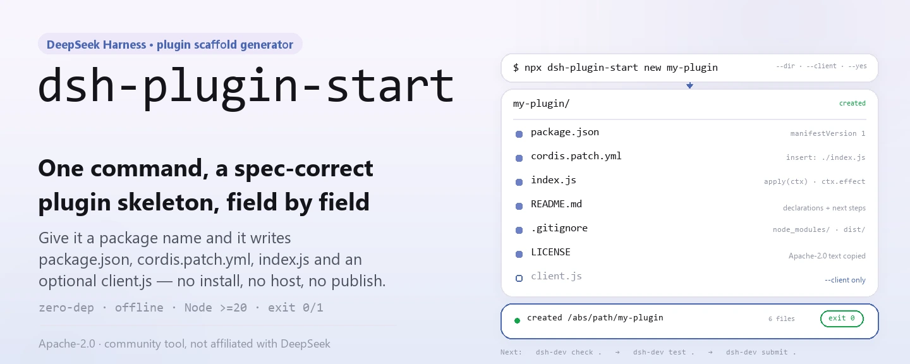
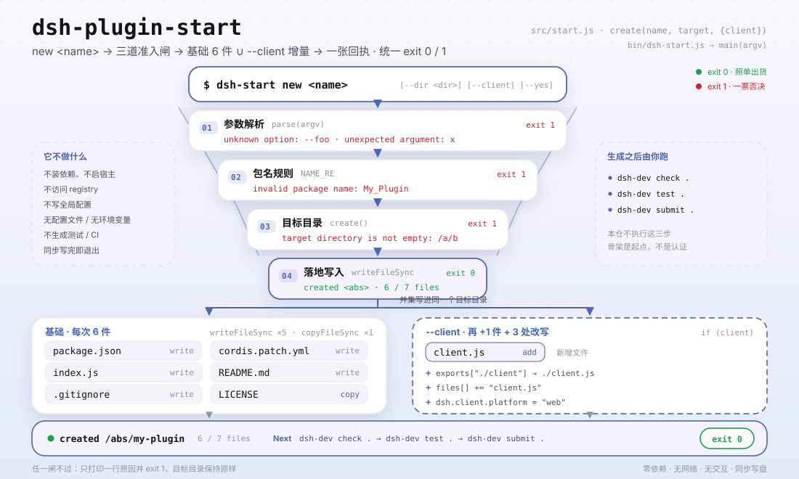

<div align="center">

<picture>
  <source media="(prefers-color-scheme: dark)" srcset="docs/assets/dsh-plugin-start-hero-en-dark.webp">
  
</picture>

# dsh-plugin-start

**Um comando gera um esqueleto de plugin do DeepSeek Harness que cumpre a especificação do host.**

Sem instalar dependências, sem iniciar um host e sem publicar: ele apenas grava `package.json`, `cordis.patch.yml`, `index.js` e, se pedido, `client.js` no diretório de destino, com a forma da especificação atual.

[Instalação](#instalação-em-três-passos) · [Configuração](#configuração) · [FAQ](#faq) · [简体中文](README.md) · [English](README.en.md) · [Español](README.es.md) · [Português](README.pt.md) · [हिन्दी](README.hi.md)

[](LICENSE)
[](https://www.npmjs.com/package/dsh-plugin-start)
[](https://github.com/PerryLink/dsh-plugin-start/actions/workflows/test.yml)
[](#desenvolvimento)

[](https://github.com/PerryLink/dsh-plugin-start/stargazers)
[](https://www.npmjs.com/package/dsh-plugin-start)
[](https://gitee.com/perrylink/dsh-plugin-start)

```sh
npx dsh-plugin-start new my-plugin
# ou instale globalmente e use o comando curto
npm i -g dsh-plugin-start
dsh-start new my-plugin
```

</div>

<sub>Ferramenta da comunidade, sem vínculo com a DeepSeek. Repositório canônico: <https://github.com/PerryLink/dsh-plugin-start> (o Gitee é um espelho).</sub>

## O que é

`dsh-plugin-start` é uma CLI Node sem dependências: você informa um nome de pacote e ela grava um esqueleto mínimo, porém atualizado, de plugin do DeepSeek Harness no diretório de destino — `package.json` (com `dsh.manifestVersion`, `dsh.bundle.patch`, `engines.dsh` e o `peerDependencies["@deepseek-ai/dsh"]` exigido pelo host), `cordis.patch.yml`, um `index.js` com a forma de liberação `ctx.effect`, além de `README.md`, `LICENSE` e `.gitignore`; com `--client` acrescenta `client.js` e a exportação `./client`.

Ele só gera: não instala dependências, não executa um host nem publica, e nunca afirma que seu plugin está pronto. Rode `npx -y dsh-standards@1.6.10 check . --scope entry --entry-claim static --no-exec` para uma checagem estática somente leitura, depois `npm pack --dry-run` e `npx -y @deepseek-ai/dsh plugin --profile demo add .` para empacotamento e um teste de instalação: é aí que o esqueleto começa a provar que serve.

<picture>
  <source media="(prefers-color-scheme: dark)" srcset="docs/assets/dsh-plugin-start-flow-v5-dark.svg">
  
</picture>

## Instalação em três passos

1. **Instalar** (escolha uma):

   ```sh
   # sem instalar nada: executa a versão publicada mais recente
   npx dsh-plugin-start new my-plugin
   # ou instale globalmente e use dsh-start
   npm i -g dsh-plugin-start
   dsh-start new my-plugin
   ```

   Requer Node.js `>=20`; o pacote não tem dependências de execução.

2. **Gerar o esqueleto** (`--dir` troca o destino, `--client` acrescenta a metade de navegador):

   ```sh
   dsh-start new my-plugin --dir ./plugins/my-plugin --client --yes
   ```

   Sem `--dir` o destino é `./my-plugin`; `--yes` é uma marca não interativa mantida para scripts: esta ferramenta nunca pergunta.

3. **Verificar** (o gerador só garante a forma dos arquivos; o que conta são as verificações):

   ```sh
   cd my-plugin
   npx -y dsh-standards@1.6.10 check . --scope entry --entry-claim static --no-exec
   npm pack --dry-run
   npx -y @deepseek-ai/dsh plugin --profile demo add .
   ```

   Em caso de sucesso ele imprime `created <caminho absoluto>` e a lista de arquivos gravados, saindo com `0`; argumentos inválidos ou um diretório sem permissão de escrita saem com `1` e o motivo específico.

**Desinstalar**: `npm uninstall -g dsh-plugin-start` (com `npx` não há nada para desinstalar).

## Capacidades principais

- **Esqueleto completo em um comando** — grava `package.json`, `cordis.patch.yml`, `index.js`, `README.md`, `LICENSE` e `.gitignore`; com `--client` acrescenta `client.js`.
- **Campos do host já preenchidos** — versão do manifesto, caminho do bundle patch, `engines.dsh` e `peerDependencies` vêm de um único gerador, então você não esquece um campo copiado de um modelo antigo.
- **Forma de liberação limpa** — `apply(ctx)` envolve os recursos em `ctx.effect(() => () => {})`, para que parar ou recarregar a quente possa desfazê-los.
- **Metade de navegador opcional** — `--client` grava `client.js` e atualiza juntos `exports["./client"]`, `files` e `dsh.client.platform = "web"`.
- **Geração de arquivos pura, sem rede e sem perguntas** — não baixa dependências, não acessa o registry e não grava estado global; os arquivos são gravados uma vez e falhas terminam com código de saída diferente de zero.

### Comandos

| Comando | Efeito |
|---|---|
| `dsh-start new <name>` | Gera o esqueleto em `./<name>`; o destino não pode existir ou precisa estar vazio |
| `dsh-start new <name> --dir <dir>` | Escolhe o diretório de destino (`-d` é equivalente) |
| `dsh-start new <name> --client` | Gera também `client.js` e a exportação `./client` |
| `dsh-start --help` · `-h` | Mostra uso, opções e a lista de arquivos gerados |
| `dsh-start --version` · `-v` | Mostra a versão (lida do `package.json` deste pacote) |

### Arquivos gerados

| Arquivo | Conteúdo principal |
|---|---|
| `package.json` | `version: "0.1.0"`, `type: "module"`, `engines.node: ">=20"`, `engines.dsh: ">=0.2.0 <0.3.0"`, `dsh.manifestVersion: 1`, `dsh.bundle.patch: "./cordis.patch.yml"`, `dsh.capabilities` / `dsh.labels` como arrays vazios |
| `cordis.patch.yml` | Uma entrada `insert` que liga `<name>` a `./index.js` |
| `index.js` | Exporta `name`, `inject = []` e `apply(ctx)`; os recursos ficam dentro de `ctx.effect` |
| `client.js` | Apenas com `--client`: exporta `name` e um `apply()` vazio |
| `README.md` | Notas de declaração, próximos comandos e lista de publicação do plugin gerado |
| `LICENSE` | Cópia do texto completo da Apache-2.0 deste repositório |
| `.gitignore` | `node_modules/`, `dist/`, `*.log`, `.DS_Store` |

## Configuração

`dsh-plugin-start` não tem arquivo de configuração, variáveis de ambiente nem estado persistente; todo o comportamento vem dos argumentos de linha de comando.

Argumentos comuns:

| Argumento | Padrão | Significado |
|---|---|---|
| `--dir <dir>` / `-d` | `./<name>` | Diretório de destino; criado se faltar, rejeitado se existir e não estiver vazio |
| `--client` | desligado | Acrescenta a metade de navegador: `client.js`, exportação `./client`, `dsh.client.platform: "web"` |
| `--yes` / `-y` | desligado | Marca não interativa; a ferramenta nunca pergunta, a opção existe para consistência com scripts |
| `--help` / `-h` | — | Mostra a ajuda e sai com `0` |
| `--version` / `-v` | — | Mostra a versão e sai com `0` |

<details>
<summary>Tabela completa de argumentos, regras de nome e códigos de saída</summary>

| Argumento | Padrão | Significado |
|---|---|---|
| `new` | obrigatório | Subcomando; hoje é o único |
| `<name>` | obrigatório | Nome do pacote, precisa corresponder a `^[a-z0-9][a-z0-9-]*$`: letras minúsculas, dígitos e hífens, começando por letra ou dígito |
| `--dir <dir>` / `-d` | `./<name>` | Diretório de destino; caminhos relativos são resolvidos contra o diretório de trabalho atual e criados recursivamente |
| `--client` | desligado | Também grava `client.js` e adiciona `exports["./client"]`, `files[]` e `dsh.client.platform` |
| `--yes` / `-y` | desligado | Marca não interativa; é analisada mas não muda comportamento algum |
| `--help` / `-h` | desligado | Imprime `usage()` e sai com `0` |
| `--version` / `-v` | desligado | Imprime a versão deste pacote e sai com `0` |

Códigos de saída:

| Código | Situação |
|---|---|
| `0` | Geração bem-sucedida, ou `--help` / `--version` |
| `1` | Nome ausente, opção desconhecida, argumento extra, nome inválido, destino não vazio ou falha de escrita |

Declarações que o gerador fixa em `package.json` (edite o arquivo gerado se precisar mudá-las):

| Campo | Valor |
|---|---|
| `dsh.manifestVersion` | `1` |
| `dsh.bundle.patch` | `./cordis.patch.yml` |
| `dsh.capabilities` | `[]` (equivale a "não usa nenhuma") |
| `dsh.labels` | `[]` |
| `engines.dsh` | `>=0.2.0 <0.3.0` |
| `peerDependencies["@deepseek-ai/dsh"]` | `>=0.2.0 <0.3.0` |
| `dsh.client.platform` | `"web"` (apenas com `--client`) |

</details>

## FAQ

<details>
<summary>Posso instalar e usar o plugin gerado imediatamente?</summary>

Ainda não. O gerador só deixa a forma dos arquivos correta; ele não instala dependências, não executa um host nem verifica o comportamento do plugin. O README gerado mostra o caminho: adicione `repository`, `homepage` e o topic `dsh-plugin`, rode a checagem estática acima e `npm pack --dry-run`, instale o checkout em um profile temporário e inicie o host uma vez; só então fale em publicar. O esqueleto é um ponto de partida, não uma certificação nem um resultado de instalação no host.

</details>

<details>
<summary>O que acontece se o diretório de destino já existir?</summary>

Se faltar, é criado recursivamente; se existir mas estiver vazio, pode receber os arquivos; se existir e não estiver vazio, aborta com `target directory is not empty: <caminho absoluto>` e código de saída `1`. Hoje não há `--force` nem opção de sobrescrita: escolha outro nome ou esvazie o diretório antes.

</details>

<details>
<summary>Ele instala dependências, inicia um host ou publica por mim?</summary>

Não para as três coisas. É um gerador de arquivos puro: sem requisições de rede, sem processos filhos, sem contato com o registry do npm e sem gravar configuração global. A geração é síncrona e termina assim que grava os arquivos; a checagem estática e o teste de instalação são sempre executados por você, de forma explícita.

</details>

<details>
<summary>O que exatamente <code>--client</code> acrescenta?</summary>

Três coisas: um `client.js` novo (exporta `name` e um `apply()` vazio), `"./client": "./client.js"` em `package.json.exports`, `client.js` em `files[]` e `dsh.client = { platform: "web" }`. Sem a opção, `exports["./client"]` continua ausente.

</details>

<details>
<summary>Por que capabilities e labels são arrays vazios?</summary>

Um array vazio diz explicitamente "não usa nenhum deles", o que é mais difícil de interpretar errado do que um campo ausente. Acrescente depois o que o código realmente usa: `ctx.fs` precisa de `fs:read` (e `fs:write` para escrever), `ctx.tools.register` precisa de `tools:register`; chamar uma API sem a declaração transforma a dica do verificador em falha. `package.json` é JSON, então não aceita comentários: os campos são a única superfície de declaração.

</details>

<details>
<summary>Há restrições no nome do pacote?</summary>

Só é aceito `^[a-z0-9][a-z0-9-]*$`: letras minúsculas, dígitos e hífens, começando por letra ou dígito. Maiúsculas, sublinhados e `@scope/name` são rejeitados com `invalid package name`. O gerador nunca reescreve o nome por você.

</details>

## Limitações conhecidas

- **Gera, não verifica.** Os campos e arquivos do modelo têm presença garantida, mas nada garante que o plugin gerado carregue, passe nas verificações ou seja utilizável; `npx -y dsh-standards@1.6.10 check . --scope entry --entry-claim static --no-exec` é o primeiro portão real.
- **Não é certificação, auditoria ou aval.** Uma geração bem-sucedida não significa aprovação oficial, entrada em um mercado ou instalação bem-sucedida no host: cada coisa exige evidência e processo próprios.
- **A faixa de versões é fixa.** `engines.dsh` e `peerDependencies` gerados ficam em `>=0.2.0 <0.3.0`; quando a especificação do host mudar, edite o `package.json` gerado à mão ou espere uma nova versão desta ferramenta.
- **Sem modo de sobrescrita.** Um destino não vazio é rejeitado; não há `--force`, mesclagem nem backup. Resolva o diretório antigo antes de regenerar.
- **Regra de nome estreita.** Nomes com escopo, maiúsculas e sublinhados não são suportados por design, para que o manifesto continue publicável diretamente.
- **Não gera testes, CI nem configuração de publicação.** A saída é o mínimo que um plugin precisa para rodar; testes, workflows e credenciais do npm são você quem adiciona.
- **Somente Apache-2.0.** O `LICENSE` é copiado tal como está deste repositório; não há opção de licença.
- **Sem interatividade.** Sem perguntas, confirmações ou assistente; `--yes` é apenas uma marca de compatibilidade para scripts.

## Desenvolvimento

```sh
git clone https://github.com/PerryLink/dsh-plugin-start.git
cd dsh-plugin-start
npm test                                  # node --test test/*.test.js
node bin/dsh-start.js --help              # executa a CLI localmente
node bin/dsh-start.js new demo --dir ../demo --yes
python scripts/gen-readme-assets.py       # regenera o hero e o diagrama em docs/assets
```

Sem etapa de build e sem dependências de execução: `bin/dsh-start.js` chama `src/start.js` diretamente e os testes usam `node:test` para cobrir três ramos em diretórios temporários (esqueleto padrão, `--client`, rejeição de destino não vazio). O script de imagens precisa de Python e Pillow e procura uma fonte CJK do sistema; se não encontrar, sai em vez de desenhar quadros vazios. O hero é gerado como par WebP zh / en; o diagrama estrutural contém apenas tokens de comandos e campos, então os cinco idiomas do README compartilham o mesmo par SVG.

Topics: `dsh`, `dsh-plugin`, `deepseek-harness`, `scaffold`, `starter`

## Família e créditos

Este projeto faz parte da família [PerryLink](https://github.com/PerryLink) de ferramentas e plugins do DeepSeek Harness (todos Apache-2.0). Se este gerador economiza o trabalho de copiar um modelo à mão, **dê uma estrela**: ela não desbloqueia nada, mas ajuda a próxima pessoa que precisar de um esqueleto a encontrá-lo.

## Licença

[LICENSE](LICENSE) (Apache License 2.0) © 2026 dsh-plugin-start contributors

<p align="center"><sub>Apache-2.0 · Ferramenta da comunidade, sem vínculo com a DeepSeek.</sub></p>
